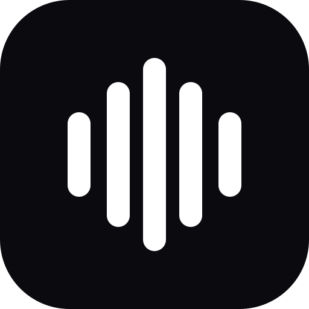
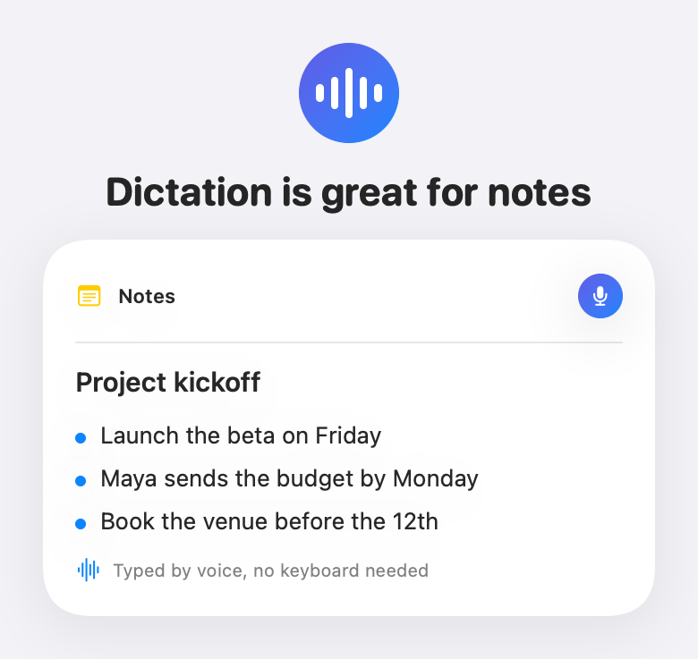
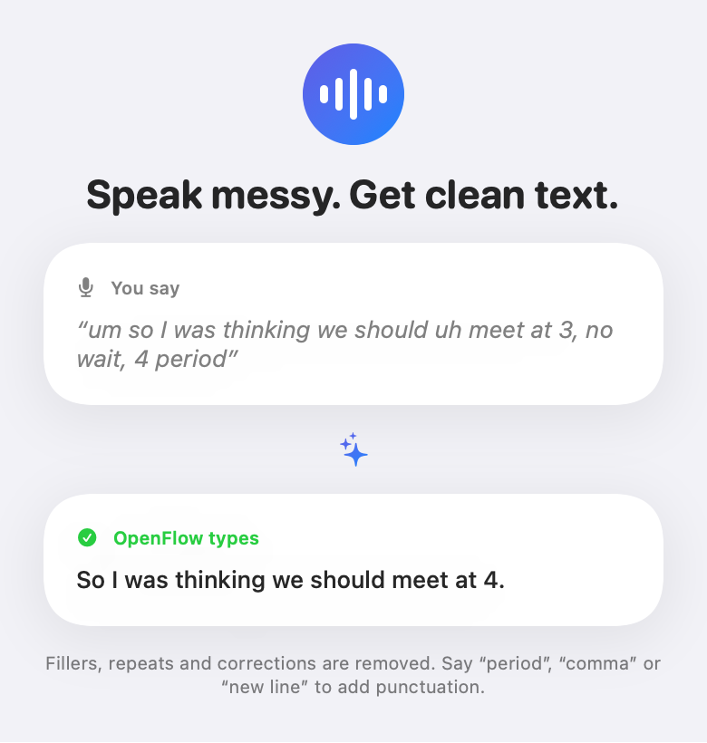
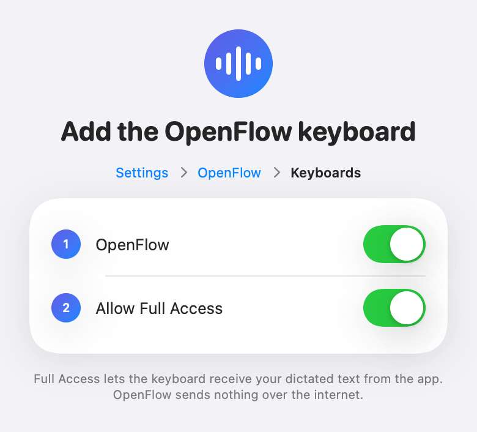

<p align="center">
  
</p>

<h1 align="center">OpenFlow</h1>

<p align="center"><b>Talk. Tap ✓. It's typed.</b><br>Free, open-source voice typing for Android and iPhone. No subscription, no account, no cap.</p>

<p align="center">
  <a href="https://github.com/PremKishore27/openflow-android/actions/workflows/build-apk.yml"></a>
  <a href="https://github.com/PremKishore27/openflow-android/releases/latest"></a>
  <a href="https://github.com/PremKishore27/openflow-android/releases"></a>
  <a href="LICENSE"></a>
  
  
</p>

Welcome in 👋 OpenFlow turns your voice into clean text in **any app**, and your messy "um so like, meet at 3, no wait, 4" into *"Meet at 4."*

- 🎙️ **One tap.** A tiny floating icon sits above your keyboard. Tap it, talk, tap ✓. Your words land where your cursor is.
- 🧠 **Whisper, on your phone.** Download the free Whisper model once. After that, dictation works offline and your voice never leaves the device.
- 🔒 **Yours.** No account, no ads, no tracking, no subscription. Open source (MIT).

### ⬇️ Get it

| Device | Download | Guide |
|---|---|---|
| 🤖 **Android 8.0+** | [**OpenFlow-Android.apk**](https://github.com/PremKishore27/openflow-android/releases/latest/download/OpenFlow-Android.apk) | [Install on Android](docs/INSTALL-ANDROID.md) |
| 🍎 **iPhone / iPad (iOS 17+)** | [**OpenFlow-iOS-unsigned.ipa**](https://github.com/PremKishore27/openflow-android/releases/latest/download/OpenFlow-iOS-unsigned.ipa) | [Install on iPhone](docs/INSTALL-IPHONE.md) |

<sub>All releases: [Releases page](https://github.com/PremKishore27/openflow-android/releases) · [What's new](CHANGELOG.md) · 💬 [Open an issue](https://github.com/PremKishore27/openflow-android/issues/new/choose) · ☕ [Support on Ko-fi](https://ko-fi.com/premboii) · 🤖 [Built with AI assistance](#about-this-project)</sub>

> **Android heads-up:** Android makes you unlock *restricted settings* before the overlay can turn on. It's a one-time thing and the app walks you through it. [Details below](#setup-android-4-steps-no-stress).

---

## The vibe

Typing on a phone is slow, and most dictation spits out a raw, messy transcript. OpenFlow keeps the keyboard you already like and adds one gesture: **talk**. It fixes the punctuation, drops the "ums", and follows your corrections, so what you send reads like you wrote it.

It's a free, open-source take on the voice-typing idea you might know from tools like Wispr Flow. No subscription, and you can read every line of code.

## Setup (Android: 4 steps, no stress)

The app shows these four steps in this order, with a ✓ next to each one when it's done:

1. **Allow the microphone.**
2. **Open Accessibility.** Find OpenFlow. Android says it's a *restricted setting*. That's expected. Don't panic.
3. **Allow restricted settings.** Back in the app, tap it, then **⋮ → Allow restricted settings**. *(That ⋮ entry only shows up after Android has blocked step 2 once.)*
4. **Turn on the overlay.** Open Accessibility again, open OpenFlow, switch it on.

Then the glow-up: in **Speech recognition**, download **Whisper Small** (375 MB, Wi-Fi) for much better accuracy. Full walkthrough with troubleshooting: **[docs/INSTALL-ANDROID.md](docs/INSTALL-ANDROID.md)**.

**Updating:** *About → Check for updates*, then install over the old version. **If you're on 0.10 or older, uninstall once first**: those builds used a temporary signing key. From 0.11 on, updates install normally.

## Setup (iPhone and iPad)

iPhone apps can't be installed from a download link, so you sideload the file with a free tool (Sideloadly or AltStore) and your own Apple ID. The app then runs a guided setup: pick what you type, add the keyboard, turn on **Allow Full Access**, allow the microphone, try it. **[Step-by-step: docs/INSTALL-IPHONE.md](docs/INSTALL-IPHONE.md)**.

With a free Apple ID the app expires after 7 days. Reinstall it the same way to refresh.

## Using it

| To do this | Android | iPhone / iPad |
|---|---|---|
| Dictate | Tap the OpenFlow icon above your keyboard, talk, tap **✓** | Switch to the OpenFlow keyboard, tap **🎙 Tap to dictate**, talk, tap stop, swipe back |
| Cancel | Tap **✕** | Swipe back without inserting |
| Move the icon | Drag it anywhere. It remembers the spot (one for keyboard open, one for closed) | n/a |
| Undo | Tap **↶ Tap to undo** for 6 seconds after typing | Delete as usual |
| Rewrite selected text | Select text, tap the icon, say "make this more formal" (needs your own API key) | n/a |

## Screenshots

**iPhone setup guide** (previews drawn by the app's own code on a Mac, not phone screenshots):

<table>
<tr>
<td width="33%"></td>
<td width="33%"></td>
<td width="33%"></td>
</tr>
</table>

Real phone screenshots of the Android overlay are on the way. If you have one to share, an [issue or PR](CONTRIBUTING.md) is welcome.

## What it does

| | Feature | Details |
|---|---|---|
| 🎙️ | **One-tap overlay (Android)** | The icon is the OpenFlow logo. One tap listens; it grows into ✕ · waveform · ✓. Drag it anywhere. |
| 🧠 | **On-device Whisper (Android)** | English Whisper Small (best) or Base (faster), free and offline. Falls back to the phone's built-in recognizer until you download it. |
| 🧹 | **Clean text** | Adds punctuation, removes fillers and stutters, follows "no wait" corrections and "scratch that". Say "comma", "period", "new line". |
| 🔤 | **Smart capitals and spacing** | Reads the text before your cursor so a continuation starts in lower case with the right spacing. |
| 📖 | **Your dictionary and snippets** | Always spell "open flow" as "OpenFlow". Say "my email" to insert your address. |
| 🎭 | **Tone per app (Android)** | Casual in chat apps, formal in mail apps. You pick the mapping. |
| ✨ | **Optional AI polish** | Bring your own Anthropic key for grammar polish and voice editing. Off by default. |
| 🔕 | **Silent mode (Android)** | One switch mutes the phone recognizer's start and stop beeps, then restores your volume. |
| 🔄 | **Update check** | *About → Check for updates* asks GitHub for the newest release. |
| 🍎 | **iPhone keyboard and setup guide** | A guided setup like Wispr Flow's, plus a big mic key. Uses Apple's recognizer for now. |

## Privacy (fr, we don't want your data)

- 🎙️ **With Whisper downloaded, your voice never leaves the phone.** Without it, Android's built-in recognizer may send audio to Google. You can switch that off in the app.
- 👀 **The accessibility permission reads only the focused text box**, to type for you and match capitals. It skips password fields, and nothing it reads is stored or sent anywhere. (If you turn on AI polish with "send text before cursor", that snippet goes to Anthropic with your own key.)
- 🌐 **The only network calls:** a one-time Whisper model download from Hugging Face, an anonymous *Check for updates* request to GitHub, and the optional Anthropic call if you add a key.
- 🚫 **No accounts, no ads, no analytics.** Your API key and settings stay in the app's private storage.
- 🔑 **Verify your download:** Android releases are signed with one permanent key. The certificate SHA-256 is `12:FC:F9:4B:20:B8:A9:13:83:98:B1:66:B3:7B:71:BD:D8:D2:49:7D:5E:A4:45:CC:84:2E:8E:F9:B2:37:A7:26`. Check with `apksigner verify --print-certs OpenFlow-Android.apk`.

## Troubleshooting

| Problem | What to do |
|---|---|
| Android: the OpenFlow switch is greyed out or says *Restricted setting* | Do setup step 3: **App info → ⋮ → Allow restricted settings**, then redo step 4. |
| Android: no *Allow restricted settings* in the ⋮ menu | It only appears after Android blocked the switch once. Try step 2 first, go back, then open the ⋮ menu again. |
| Android: the icon never shows up | Check that step 4 shows ✓ On. Tap into a normal text box, not a password field. |
| Words are often wrong | Download **Whisper Small** in *Speech recognition*. It's far more accurate than the built-in recognizer. |
| A word like "Message" appears before my text (WhatsApp, etc.) | Update to 0.13 or newer. If another app shows a different grey hint, add it under **Placeholder text to ignore** in the app. |
| Whisper feels slow | Switch to **Whisper Base**. |
| Beeps when I start and stop | Turn on **Silence microphone beeps** under *Behaviour*. |
| iPhone: the keyboard says *Allow Full Access* | Settings → OpenFlow → Keyboards → **Allow Full Access**. |
| iPhone: *Tap to dictate* does nothing | Open the OpenFlow app once, finish the setup guide, try again. |
| iPhone: the app stopped opening after a week | Free Apple ID limit. Reinstall with Sideloadly or AltStore. |

Anything else: [open an issue](https://github.com/PremKishore27/openflow-android/issues/new/choose).

## Limits (being real)

- **English only** for now. Whisper needs a 64-bit Android phone and a one-time 160–375 MB download.
- Whisper types after you tap ✓, so you won't see words appear while you talk.
- **iPhone:** no Whisper yet (it uses Apple's recognizer), you need a computer to sideload, and iOS won't let a keyboard use the mic, so the app opens to record and you swipe back.
- Some apps with custom text boxes (games, canvas editors) ignore text typed by accessibility tools.
- Still new: it has been tried on few phones. If something breaks, tell me.

## FAQ

**Is this the same as Wispr Flow?** No. It's an independent, free, open-source project in the same spirit. It isn't affiliated with Wispr.
**Why does Android make me do all that restricted-settings stuff?** Android blocks apps installed outside the Play Store from using accessibility until you allow it. The overlay needs accessibility to show the icon and type for you.
**Is it on the Play Store or the App Store?** Not yet. Google restricts accessibility apps and Apple needs a paid account, so releases live here on GitHub.
**Do I need an API key?** No. Everything works without one. A key only adds optional AI polish and voice editing.
**Can I use it with my own words and names?** Yes: *Dictionary* and *Snippets* in the app.

## Build from source

**Android** (JDK 17, Android SDK 35, `bash` + `curl`; the first build downloads the pinned [sherpa-onnx](https://github.com/k2-fsa/sherpa-onnx) library by itself):

```bash
git clone https://github.com/PremKishore27/openflow-android.git
cd openflow-android
./gradlew test assembleDebug     # app/build/outputs/apk/debug/app-debug.apk
```

**iPhone and iPad** (Mac with Xcode 26): open `ios/OpenFlow.xcodeproj`, set your Team under *Signing & Capabilities* for both targets, press Run. Details in [the iPhone guide](docs/INSTALL-IPHONE.md).

Pushes to `main` build both apps on GitHub Actions. Version tags (`v*`) publish a [Release](https://github.com/PremKishore27/openflow-android/releases) with the signed APK and the unsigned `.ipa` attached.

<details>
<summary>Project structure</summary>

| File | Role |
|---|---|
| `OpenFlowService.kt` | The accessibility service: floating icon, tap and drag, writes text into the focused field |
| `Dictation.kt` · `LocalDictation.kt` · `LocalWhisper.kt` · `Models.kt` | Speech: the phone's recognizer, plus on-device Whisper with a verified model download |
| `Cleanup.kt` · `ContextFit.kt` | Text cleanup and capitals/spacing (ported to Swift for iPhone) |
| `Llm.kt` | Optional Anthropic polish and voice editing |
| `Updates.kt` | Update check against GitHub releases |
| `SettingsActivity.kt` · `Prefs.kt` · `LogoView.kt` · `WaveformView.kt` | Setup and settings screen, stored settings, drawn views |
| `ios/` | iPhone app (SwiftUI), keyboard extension, shared Swift code |
| `scripts/` | Library fetch, signing-secret upload, icon generator |

</details>

## Roadmap

- [x] One-tap overlay you can drag anywhere
- [x] On-device Whisper on Android
- [x] iPhone app and keyboard with guided setup
- [x] Update checks, permanent signing key
- [x] Minimal monochrome icon
- [ ] Whisper on iPhone
- [ ] More languages
- [ ] Real Android screenshots in this README
- [ ] F-Droid / IzzyOnDroid listing

---

## About this project

OpenFlow is made by one person, [PremKishore27](https://github.com/PremKishore27), in their free time. **It is developed with the help of an AI assistant, Claude (by Anthropic):** the AI writes much of the code, tests and documentation under my direction. I decide what the app does, try the builds, and choose what gets released. Automated tests run on each change. If you find a bug, please [open an issue](https://github.com/PremKishore27/openflow-android/issues/new/choose).

## Support

OpenFlow is free and always will be. If it saves you time, you can [buy me a coffee on Ko-fi](https://ko-fi.com/premboii) ☕. It's never required, and nothing is locked behind it. Starring the repo and telling a friend helps just as much ⭐

## License and credits

[MIT](LICENSE). Uses [sherpa-onnx](https://github.com/k2-fsa/sherpa-onnx) (Apache-2.0) and OpenAI's Whisper models (MIT). See [THIRD_PARTY_NOTICES.md](THIRD_PARTY_NOTICES.md).

## Contributing

Bug reports, ideas and pull requests are welcome: see [CONTRIBUTING.md](CONTRIBUTING.md). Please read the [Code of Conduct](CODE_OF_CONDUCT.md) and, for security problems, [SECURITY.md](SECURITY.md).

---

<sub>OpenFlow is an independent project and is not affiliated with, endorsed or sponsored by Wispr or Wispr Flow. Android, Google, Apple, iPhone and other names are trademarks of their owners.</sub>
